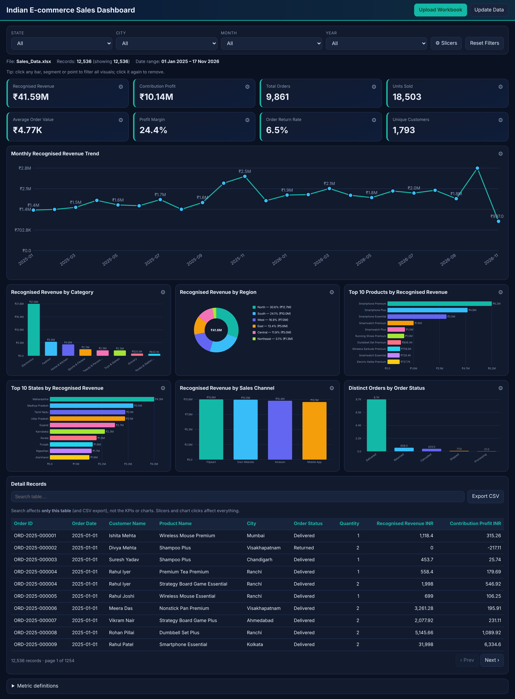

<div align="center">

# 📊 Indian E-commerce Sales Dashboard

**An interactive, dark-themed sales analytics dashboard in a single HTML file. No installation, no server, fully offline.**

[](https://prachi074.github.io/Ecommerce-Sales-Dashboard/)


</div>



## 🔍 Overview

This dashboard turns an Excel sales workbook into a fully interactive analytics view. It opens with a built-in dataset of **12,536 order lines (Jan 2025 – Nov 2026)** so you can explore it instantly, and you can upload your own workbook at any time. Everything runs in the browser; your data is never sent anywhere.

## ✨ Key Features

| Feature | Details |
|---|---|
| 🎛️ **4 configurable slicers** | State, City, Month and Year by default. Any slicer can be swapped for any other column in the data. All slicers work together. |
| 📈 **8 KPI cards** | Recognised Revenue, Contribution Profit, Total Orders, Units Sold, Average Order Value, Profit Margin, Order Return Rate, Unique Customers. Each card has its own format settings (Auto / Actual / K / M, 0–2 decimals). |
| 👆 **Click-to-filter charts** | Click any bar, segment or point to filter every KPI, chart and the table. Click it again (or use the filter chip) to remove it. |
| 📊 **7 charts** | Monthly revenue trend, revenue by category, region, sales channel, top 10 products, top 10 states, and orders by status. Each has settings to show or hide values and axis labels. |
| 📋 **Detail table** | Searchable, paginated, with CSV export of the filtered records. |
| 🔄 **Upload / Update Data** | Load any workbook with the same structure. *Update Data* replaces the dataset with the latest snapshot (no duplicates) and reports how many new records were found. |
| ✅ **Data validation** | Checks for the `Sales Data` sheet, required columns and duplicate Line IDs, with clear error messages. |
| 🌙 **Responsive dark UI** | Navy and teal theme that works on desktop, tablet and mobile. |

## KPI Definitions

- **Recognised Revenue:** sum of *Recognised Revenue INR*
- **Contribution Profit:** sum of *Contribution Profit INR*
- **Total Orders:** distinct *Order ID* (multi-line orders are counted once)
- **Units Sold:** sum of *Quantity* for Delivered records only
- **Average Order Value:** recognised revenue ÷ distinct Delivered orders
- **Profit Margin:** total contribution profit ÷ total recognised revenue
- **Order Return Rate:** distinct Returned orders ÷ distinct (Delivered + Returned) orders
- **Unique Customers:** distinct *Customer ID*

Percentage KPIs are calculated from total numerators and denominators, never by averaging row-level percentages. Zero denominators are handled safely.

## How to Use

1. **Try it instantly:** open the [live demo](https://prachi074.github.io/Ecommerce-Sales-Dashboard/). The dashboard loads with the built-in data.
2. **Use your own data:** click **Upload Workbook** (top right) and select an `.xlsx` file with a sheet named `Sales Data` and the same column names.
3. **Refresh with new data:** click **Update Data** and choose the latest complete workbook.
4. **Run locally:** download `index.html` and open it in any modern browser (Chrome, Edge, Firefox).

🔒 **Privacy:** All processing happens locally in your browser. Uploaded workbooks are never sent to any server, and refreshing the page clears them.

## 📁 Repository Structure

```
├── index.html          # Complete dashboard (HTML + CSS + JavaScript + built-in data)
├── dashboard-full.png  # Dashboard preview
├── Sales_Data (2).xlsx # Sample workbook to try the Upload Workbook feature
└── README.md
```

## Tech Stack

- **HTML5, CSS3, JavaScript (vanilla)**, with no external libraries or internet connection required
- Custom SVG charts
- Native browser APIs for reading `.xlsx` files

## 🤖 How This Was Built

This dashboard was built with AI assistance (Claude). I wrote the project requirements and KPI definitions, then reviewed and tested the output against my sales data.

## 👩‍💻 About Me

I'm a data analyst skilled in **Python, SQL, Excel and Power BI**, with end-to-end projects across these tools. I'm open to data analyst roles and internships.

⭐ If you found this project useful, consider giving the repository a star!

## Author
**Prachi Vaishkiyar**
